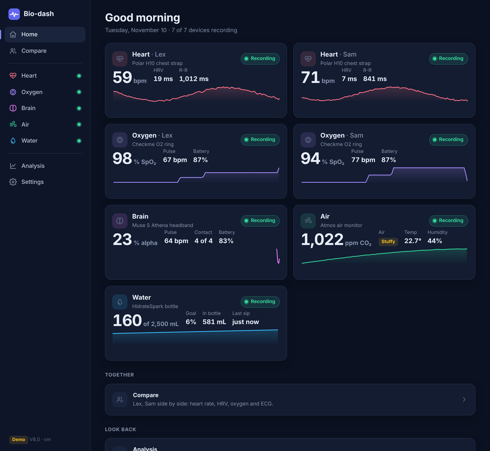
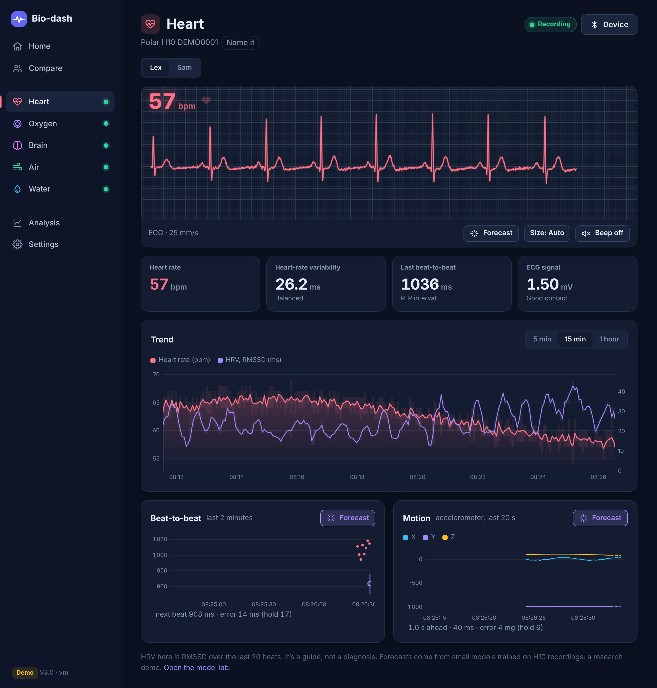
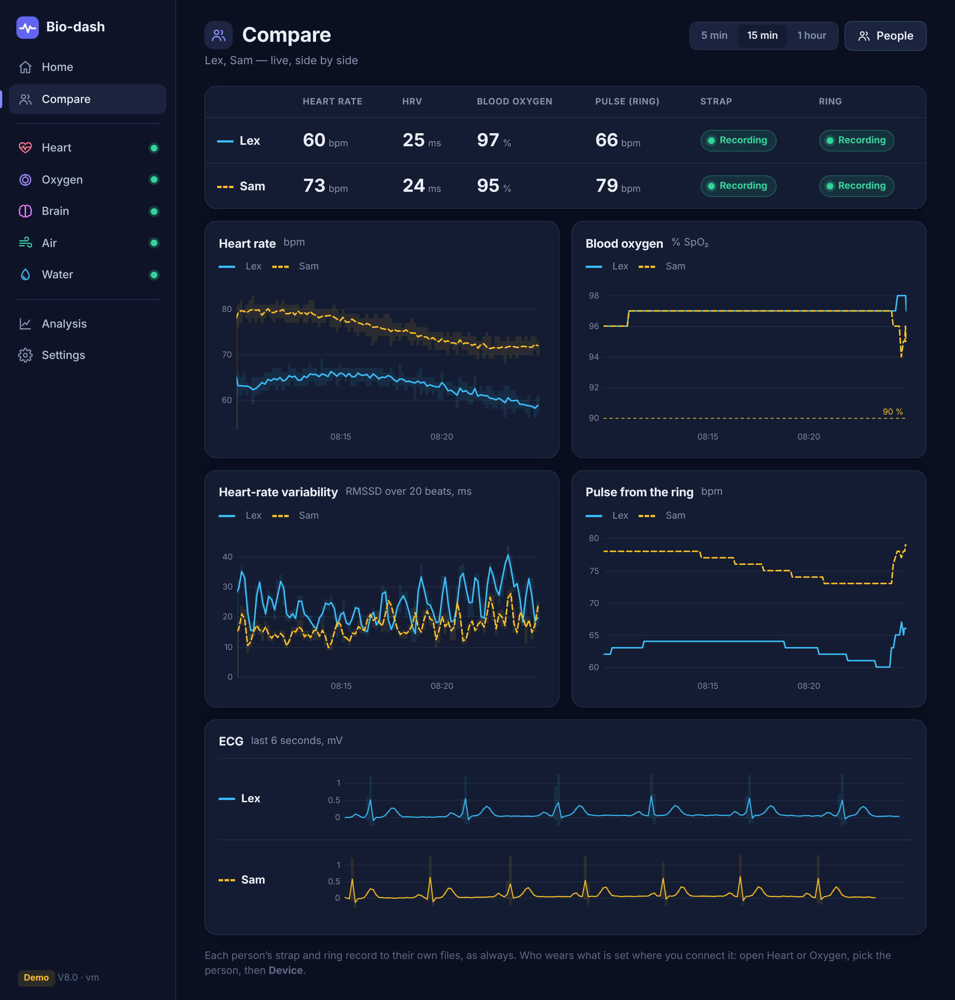
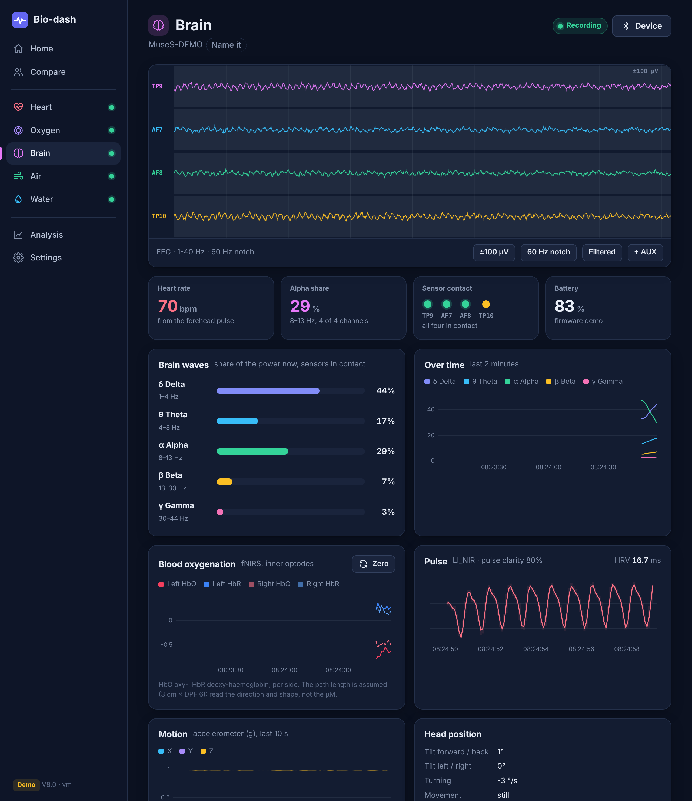
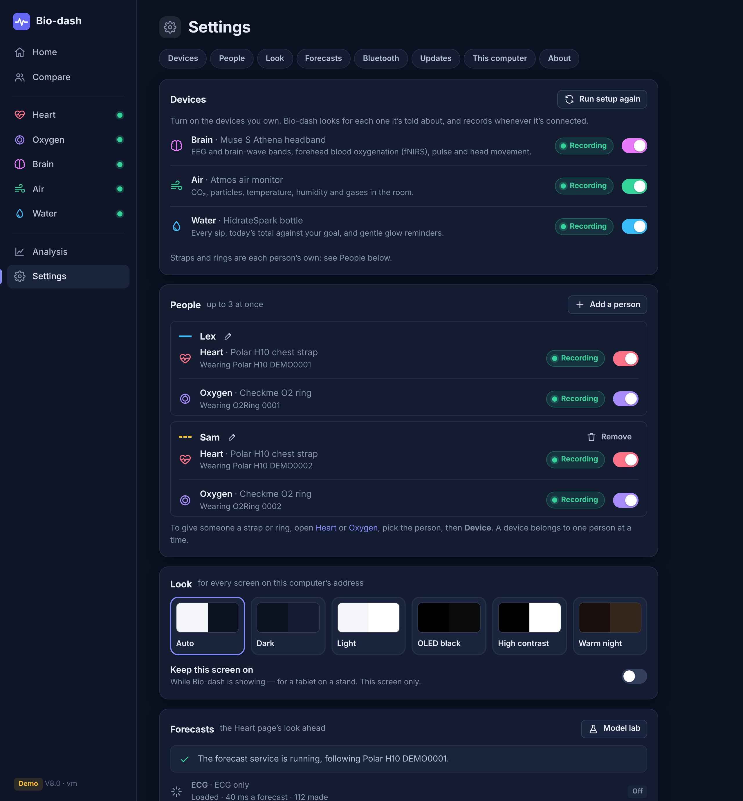
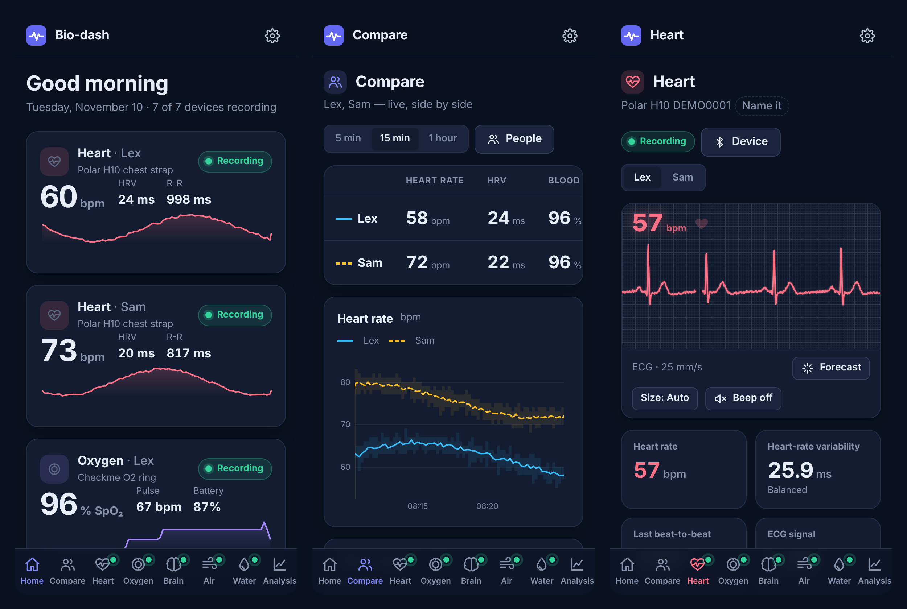
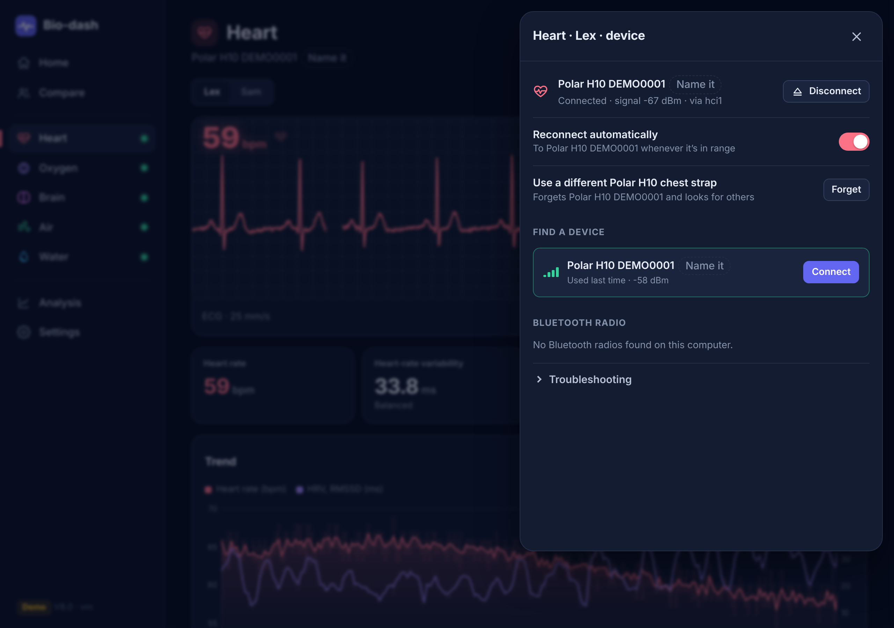

# Bio-dash

**One app for your heart, oxygen, brain, air and water — for up to three people at once.** Bio-dash connects to Bluetooth health and home
sensors, shows them live on any screen in the house, and records everything to plain CSV files on
your own computer. Built for Linux with BlueZ (Jetson Orin Nano, x86 laptops, a Raspberry Pi).

| | Device | What you get |
|---|---|---|
| **Heart** | Polar H10 chest strap | Live ECG (bedside-monitor style), heart rate, HRV, beat-to-beat, motion |
| **Oxygen** | Checkme O2 ring (Viatom / Wellue, advertises as `Band-WU …`) | SpO₂, pulse and battery, live and over the night |
| **Brain** | Muse S Athena headband | Live EEG, brain-wave bands, forehead blood oxygenation (fNIRS), pulse, head movement |
| **Air** | Atmos-Mini, Atmos-Sphere S4 / S5, or anything sending CSV / key=value / JSON over Nordic UART or Wi-Fi | CO₂, particles, temperature, humidity, VOC, NOx, formaldehyde, with plain-language advice |
| **Water** | HidrateSpark PRO / PRO 2 bottle | Every sip, today against your goal, the week, glow reminders, a goal that follows the weather |
| **Compare** | *(two or three people)* | Everyone's heart rate, HRV, SpO₂ and ECG side by side, live |
| **Analysis** | *(no device)* | Any day or range: summaries, night reports, every signal on one chart, CSV export |



> ⚠️ **Not a medical device.** HRV words and SpO₂ bands are rough guides for curiosity, not diagnosis.

## Quick start

```bash
./setup_env.sh          # once: creates .venv/ with everything it needs (Python 3.10+)
./launch.sh             # then open http://localhost:5000
```

The first time, a short setup asks which devices you have and finds each one. After that Bio-dash
reconnects by itself whenever a device comes back in range.

**Try it without any devices:** `./launch.sh --demo` runs with made-up readings (in a scratch folder;
your real recordings aren't touched).

**Open it on your phone:** `http://<computer-name>.local:5000` on the same network. In the phone's
browser menu, *Add to Home Screen* makes it an app icon.

**Keep it running in the background** (and at boot, for a headless Orin):

```bash
./biodash.py            # asks a few questions, then installs one service
./biodash.py status     # running? where to open it
./biodash.py logs -f    # what it's doing, every device included
```

## What's new in V8

V8 puts everything since the first one-app design back into **one app**: one address, one port
(5000), one service. Your recordings are exactly the same files as before.

- **One app.** Up to V7.0 Bio-dash was separate dashboards on ports 5000 – 5006. Heart, Oxygen,
  Brain, Air, Water, Compare, Analysis and Settings are now pages of one app, with one WebSocket,
  one small chart library and no build step.
- **People.** Settings → People adds a second and third person. Each gets their own strap and
  ring, a switcher on the Heart and Oxygen pages, and a line (a colour *and* a line style) on the
  new **Compare** page. One person works exactly as before.
- **Brain.** The Muse S Athena dashboard as a page, redrawn in the app's charts.
- **Forecasts.** The three H10 models (ECG, ECG + accelerometer, ECG + R-R) each have a *Forecast*
  button by their chart on the Heart page; the model lab is at `/lab`.
- **A proper Settings page:** Devices, People, Look (themes, keep this screen on), Forecasts,
  Bluetooth radios, Updates, This computer, About.
- **Sturdier:** the Polar worker has both the disconnect / switch commands and the plain-language
  "the strap refused the stream" handling; each page follows its own device's recording.

See [CHANGELOG.md](CHANGELOG.md) for the full list, and *Upgrading* below.

## The pages

| | |
|---|---|
|  |  |
|  |  |



- **Home** — a card per device: the newest reading, the last half hour, and what to do if it isn't
  connected.
- **Heart** — the ECG sweeps like a bedside monitor (tap *Size* for the gain, *Beep* for a tone per
  beat); heart rate, HRV (RMSSD of the last 20 beats), R-R and ECG signal strength (low means the pads
  need wetting); trend over 5 min – 1 h; beat-to-beat and motion. With the models installed, a
  *Forecast* button by the ECG, the beat-to-beat chart and the motion chart draws what each model
  expects next (see *Live forecasts*). With several people, a switcher under the title picks whose.
- **Oxygen** — SpO₂, pulse and the ring's battery; the last 15 min – 24 h with the lowest, the
  average and time below 95 % and 90 %.
- **Brain** — the EEG in four lanes (scale, mains notch, filtered / raw, + AUX); heart rate from the
  forehead, alpha share, sensor contact and battery; the five bands now and over 2 minutes; fNIRS
  (HbO / HbR per side, *Zero* for a new baseline); the pulse wave; head position. *What the headband
  sends* picks the preset.
- **Compare** — appears with two or three people: a row each for heart rate, HRV, SpO₂ and the
  ring's pulse; shared charts over 5 min – 1 h; everyone's ECG under each other.
- **Air** — one line on how the air is (“Fresh”, “Stuffy — open a window”), a tile per reading with
  its band (CO₂, PM2.5 by the US EPA's 2024 breakpoints, VOC index), charts for 15 min – 24 h, and
  any field Bio-dash doesn't know yet. *Device options* picks the Atmos model if readings land in the
  wrong boxes, and connects a Wi-Fi Atmos-Sphere by address.
- **Water** — today against the goal with your pace (“About 300 mL behind — 250 mL an hour gets you
  there by 22:00”), today's curve, by hour, the last 7 days and every sip. Settings: the goal and
  *How much should I drink?* (weight, exercise and today's local forecast, optionally every
  morning), bottle size, calibration, glow reminders and glow style.
- **Analysis** — pick a day (the strip shows which days have recordings) or a range: what was
  recorded when, the numbers per device, night reports, any signal on a chart, CSV export. When a
  range holds more than one strap or ring, you pick which one, so two people aren't mixed.
- **Settings** — which devices you have; people; themes and *Keep this screen on*; the forecast
  service; Bluetooth radios; updates; restart / shut down; where recordings go.

### The Device sheet

Every device page has a **Device** button:



- **Disconnect** (Heart, Brain) — ends the session; it then waits for you to pick a device.
- **Reconnect automatically** — on by default, to the device you used last.
- **Use a different …** — forgets this one and looks again.
- **Find a device** — what the last scan heard, with signal bars and a Connect button each. A strap
  or ring belongs to one person at a time: one that someone else has says so, and *Move here*
  takes it over.
- **Bluetooth radio** — *Automatic* (the Polar prefers a USB dongle, the rest the built-in radio;
  with several people each strap gets a radio of its own where there are enough) or pin one. See [Radios on the Orin](docs/ARCHITECTURE.md#9-radios-on-the-orin-what-plugs-in-where).
- **Troubleshooting** — restart the device's connection, its recent messages, *Copy details* for a
  bug report.

## Where recordings are saved

Unchanged. Every device saves to your **Documents** folder, by device, then unit, then date:

```
~/Documents/Bio-dash/
├── Polar H10/Polar H10 D793BB2E/2026-09-30/14-05-12_ecg.csv · _acc · _rr
├── Viatom O2/Band-WU 0347/2026-09-30/14-05-12_vitals.csv          SpO₂, HR, battery every 5 s
├── Atmos/Atmos-Sphere-S4 (XX-XX-XX-XX-XX-XX)/2026-09-30/14-05-12_readings.csv
├── Muse/MuseS-1A2B/2026-09-30/         _eeg · _optics · _imu · _bands · _heart · _fnirs · _battery
├── HidrateSpark/h2o 3F2A/2026-09-30/   _sips · _status · _events · _raw
└── Omni/…                               (V5 – V7 only; still read by Analysis)
```

- **One set of files per connection**, named by the time it started; timestamps are absolute.
- **Location:** your desktop's Documents folder (`~/.config/user-dirs.dirs`), else `~/Documents`.
  `BIODASH_DATA_DIR=/some/path` puts them anywhere else.
- **Power cuts:** recordings are pushed to disk every 10 s (`BIODASH_FSYNC_S`), and zero bytes left
  by a cut are cleaned up at the next start.
- **Several people:** recordings stay per device, as above. Who wore which strap is in
  `~/.config/bio-dash/` (`app.json`, `people/`), not in the recordings.
- Nothing is written inside the repo, so recordings can't be committed by accident.

## Running it

| | |
|---|---|
| `./launch.sh` | In this terminal; Ctrl+C stops. `--port 8080`, `--demo` |
| `./biodash.py` | Install the background service (questions), or `install` with `--port`, `--no-keep-awake`, `--lid`, `--no-reconnect`, `--allow-power`, `--boot` |
| `./biodash.py status · start · stop · restart · logs [-f] · uninstall` | |
| `./setup_env.sh [--fresh]` | Create or rebuild `.venv/` |

- **Keeps the computer awake** while it runs (idle and suspend; `--lid` for lid-close too).
- **Restart / shut down / updates** from Settings work from this computer; `--allow-power` allows
  them from other devices too (e.g. your phone in a backpack setup).
- **Updates:** Settings → Updates checks GitHub; *Apply fixes* updates this version in place,
  *Upgrade* moves to a newer version folder with your settings. Needs a `git clone`.

### Upgrading

From an older dashboard: **Updates → Upgrade to V8.0**. Or by hand:

```bash
cd V8.0_Dashboard && ./setup_env.sh && ./biodash.py install
```

- The old per-dashboard services (`biodash-polar`, `biodash-muse`, `biodash-omni` …) are removed
  and the devices they ran are turned on in the app; paired devices, radio pins, the Atmos profile,
  the headband's preset and the bottle's goal and calibration carry over.
- The app is on **port 5000**. Bookmarks to 5001 – 5006 stop working.
- **Omni's people don't carry over** (V7.0): add them in Settings → People and connect each
  person's strap and ring once. Omni's recordings still appear in Analysis.

## Project layout

```
V8.0_Dashboard/
├── server.py            the app: worker supervisor, device APIs, people, live hub, the page
├── web/                 the page: index.html, lab.html, css/app.css, js/ (app, store, ui, device,
│                        plot, ecg, eeg, forecast, wake, pages/)
├── bt_debug.py          shared: radios, auto-reconnect, recordings, shutdown, updates
├── polar_dashboard/     Heart:  advanced_worker.py + api.py; forecast_service.py + forecast/ (models)
├── viatom_dashboard/    Oxygen: ble_worker.py + api.py
├── muse_dashboard/      Brain:  muse_worker.py + api.py + muse_protocol.py, muse_signal.py
├── atmos_dashboard/     Air:    sensor_worker.py + api.py + atmos_parser.py
├── hydro_dashboard/     Water:  hydro_worker.py + api.py + hydro_protocol.py, water.py
├── analysis_dashboard/  Analysis: api.py + analysis_jobs.py + biodata.py + mcint.py, waves.py
├── tools/               night_report · interpolate · export_mcint · export_ecg · export_waves ·
│                        fleet · ble_scan · radio_compare · forecast_timing · demo_feed · orin_setup.sh
├── biodash.py           the background service
├── launch.sh · service_run.sh · setup_env.sh · updater.py · restart_all.py
├── test_server.py       end to end with made-up devices (API, people, forecasts, recordings)
├── test_web.py          every page in a real browser (Playwright)
├── test_radios.py · test_scan_hang.py   sharing radios between people; a Bluetooth scan that never answers
└── docs/ARCHITECTURE.md how it all fits, with diagrams
```

Every device folder is the same pair: a **worker** (the Bluetooth program) and **api.py** (its
web API, mounted by the server at `/api/d/<device>`).

**Checks:** `python3 test_server.py`, `python3 test_web.py`, and each folder's `test_*.py`
(`node hydro_dashboard/test_water_calc.js` for the pace maths).

## Troubleshooting

A flowchart that walks from what you see to the fix: [docs/ARCHITECTURE.md section 10](docs/ARCHITECTURE.md#10-when-somethings-wrong).

| Symptom | Likely cause |
|---|---|
| A device is never found | Asleep, or connected to its phone app (close the app — each device talks to one thing at a time). The *Not showing up?* tips under each search list what to try. |
| The O2 ring never appears | It stops advertising shortly after it comes off the finger. Keep it on while it searches. |
| First Polar connect fails | Common BlueZ `le-connection-abort-by-local`; it retries 3× by itself. |
| Heart says *the strap refused the … stream* | The page says why. *Invalid MTU*: the Bluetooth link's packet size is too small for ECG — check `ExchangeMTU` isn't set in `/etc/bluetooth/main.conf`, try the other radio, or `sudo systemctl restart bluetooth`. *Busy*: something else is streaming from the strap (a V5 dashboard still running, the Polar Beat app). Heart rate keeps recording either way. |
| A device page says *Restarting…* | Its Bluetooth worker stopped. **Device → Troubleshooting** shows why (often BlueZ: `sudo systemctl restart bluetooth`). |
| ECG drops, jumpy readings | Weak signal (under −85 dBm in the Device sheet): move closer, or pin the device to a USB dongle. |
| One person's page stays on "Looking…" while the strap is on | Update to the latest V8.0 patch: a search that hangs in Bluetooth is now retried, and the worker restarted. Its messages are under Device → Troubleshooting. |
| Two people, one strap drops or stalls | Each streaming H10 wants a radio to itself. Settings → Bluetooth radios warns when there are more straps than radios: add a USB dongle per extra strap. |
| Other devices stall while the H10 streams | The H10 is monopolising its radio. Plug in a USB dongle; *Automatic* moves the Polar onto it. |
| Air readings in the wrong boxes | Air → *Device options* → pick the Atmos model. |
| Bottle: see [hydro_dashboard/TROUBLESHOOTING.md](hydro_dashboard/TROUBLESHOOTING.md) | |
| Live readings never arrive, but pages load | The WebSocket package is missing: `./setup_env.sh` (it installs `uvicorn[standard]`). |
| Which strap / ring / bottle is mine? | Tap the tag next to a device (finder, page header, Device sheet) and name it, e.g. Mine or Boss's. Kept in `~/.config/bio-dash/device_names.json`. |
| Bluetooth stuck ("device busy", won't reconnect), or an old version still running | Settings → This computer → **Restart Bio-dash** (or `./restart_all.py`): stops every Bio-dash process from any release, resets Bluetooth, starts again. `--dry-run` shows what it would do. |
| The service won't start | `./biodash.py logs`. Over SSH, `systemctl --user` needs a login once, or `./biodash.py install --boot`. |
| Orin won't boot with dongles plugged in | See [the boot catch](docs/ARCHITECTURE.md#the-boot-catch-whats-plugged-in-at-power-on). |

## More tools

- **Overnight SpO₂ report** — `python3 tools/night_report.py [2026-10-05]` writes
  `Documents/Bio-dash/Reports/night_<date>.html` (also linked from Analysis → Nights).
- **One table from every device** — `python3 tools/interpolate.py 2026-10-07 --step 1min --minmax`,
  the command-line version of Analysis → *Download CSV*.
- **For ReaLLM-Forge** — `python3 tools/export_mcint.py 2026-10-07 --step 10s` (or Analysis →
  *For ReaLLM-Forge*) writes the same table as an integer CSV that ReaLLM-Forge's `data/csv_mc_int`
  takes as it is: decimals kept by scaling (`temp_c_x10`), time as `minute_of_day` / `second`, a
  fixed range per signal so different days share vocabularies, and `-1` where a device wasn't
  recording. It comes with `<name>.columns.json` and `<name>.prepare.sh` (`get_dataset.sh` with every
  `--range`); `--forge ~/ReaLLM-Forge` builds the datasets in one go, and
  `tools/mcint_decode.py` turns sampled CSVs back into real units.
- **Recordings from your other machines** — `./tools/fleet.py check` lists what each online Tailscale
  machine (tagged `tag:ssh`) has recorded; `./tools/fleet.py pull` copies what's new into
  `Documents/Bio-dash-machines/<machine>/`, or `--merge` into this computer's recordings without
  overwriting anything (a clashing recording is kept as `<device> @<machine>`). `./tools/fleet.py push --to
  gdrive:Bio-dash` uploads everything to any cloud rclone knows (new and grown files only; use an rclone
  crypt remote to encrypt); `./tools/fleet.py schedule` does that by itself every 5 minutes (the ECG and motion
  waveforms hourly). Plain ssh, nothing to install on the other side. Notes at the top of the file.
- **Just the ECG** — `python3 tools/export_ecg.py 2026-10-07` writes the Polar H10's ECG on its own:
  every sample with its timestamp (`_raw.csv`), and an even 200 Hz with no timestamp (`_200hz.csv`,
  interpolated within each unbroken stretch; `_200hz_stretches.csv` says where the gaps were).
  `--method cubic` follows QRS peaks more closely; `--uv` gives whole microvolts for csv_mc_int; `--with-acc` adds the strap's motion
  (`ACC_X_mg,ACC_Y_mg,ACC_Z_mg`) on the same 200 Hz rows, plus `_acc_raw.csv`.
- **Live forecasts** — the Heart page's *Forecast* buttons: a band (the range of 8 sampled futures)
  and a dashed line ahead of the ECG pen and on the motion chart, and the next beats on the
  beat-to-beat chart, each with its running error beside "repeat the last value". Research demos
  trained on one person's data, not a medical device. `server.py` starts
  `polar_dashboard/forecast_service.py` when a model is in `polar_dashboard/forecast/models/` and
  Heart is on; it follows the first person's strap. It needs PyTorch and transformers in this
  Python or in `BIODASH_FORECAST_PYTHON`, and a GPU to keep up (on a CPU the page says the
  forecasts arrive too late). On a Jetson Orin, `tools/orin_setup.sh` installs it all.
  `BIODASH_FORECAST=0` leaves it off; `python3 polar_dashboard/forecast_service.py --bench` times
  it. **The model lab** (`/lab`, linked from the Heart page and Settings → Forecasts) is
  ReaLLM-Forge's Stream Lane Lab viewer with the live strap as a source. Details:
  `polar_dashboard/forecast/README.md`.
- **The model's rows** — `tools/export_waves.py` writes the ECG (and `--with-acc` the motion) on the
  125 Hz grid the models were trained on, as a csv_mc_int dataset; `analysis_dashboard/waves.py` is the
  shared code, live and offline.
- **Replaying a session** — `polar_dashboard/replay_session.py` plays a recording back as if the strap
  were on, to test the forecast. It writes to a test folder (`BIODASH_DATA_DIR`), never into your
  recordings unless told to, and replays are kept out of Analysis, the exporters and `fleet.py`.
- **What's around** — `python3 tools/ble_scan.py` lists every Bluetooth LE device the radio hears
  (Find My, Fast Pair, iBeacon, heart-rate straps …).

## Acknowledgements

- **[klei22/viatom-ble](https://github.com/klei22/viatom-ble)** (forked from
  [ecostech/viatom-ble](https://github.com/ecostech/viatom-ble), MIT) — the Python script for reading
  Viatom / Wellue oximeters that the Oxygen page, and with it the whole project, started from.
- HidrateSpark protocol documentation from
  [loryanstrant/HidrateSpark-MQTT-bridge](https://github.com/loryanstrant/HidrateSpark-MQTT-bridge),
  [bditter/HA-Hidratespark](https://github.com/bditter/HA-Hidratespark) and
  [maxperron/HydroSync](https://github.com/maxperron/HydroSync) — see `hydro_dashboard/PROTOCOL.md`.
- Weather for the water goal: [Open-Meteo](https://open-meteo.com).
