# How Bio-dash works

Flow diagrams for the whole suite, from the devices to the files on disk. GitHub renders the
diagrams below; elsewhere, paste a block into <https://mermaid.live>.

1. [The big picture](#1-the-big-picture) — devices, radios, the one server, recordings
2. [Inside the server](#2-inside-the-server) — how a worker, its API and the page talk; several people; forecasts
3. [A device's life cycle](#3-a-devices-life-cycle) — scan, connect, record, reconnect
4. [Hydro-dash: the bottle protocol](#4-hydro-dash-the-bottle-protocol)
5. [Atmos: from any sensor format to tiles](#5-atmos-from-any-sensor-format-to-tiles)
6. [Starting and running everything](#6-starting-and-running-everything)
7. [Hydro-dash: which Bluetooth radio](#7-hydro-dash-which-bluetooth-radio) — the old-dongle catch
8. [Analysis: from recordings to one clock](#8-analysis-from-recordings-to-one-clock)
9. [Radios on the Orin: what plugs in where](#9-radios-on-the-orin-what-plugs-in-where) — every adapter tried, and the boot catch
10. [When something's wrong](#10-when-somethings-wrong) — a troubleshooting flowchart

**Colour key** (same in every diagram):

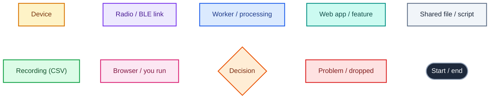

---

## 1. The big picture

**One app.** A single server (`server.py`, one port, one service) runs a Bluetooth **worker** for
each device you turned on, serves each device's API, and sends live readings to every open page
over one WebSocket. The workers are the same programs as in the separate dashboards (V5 – V7) and
write the same recordings.

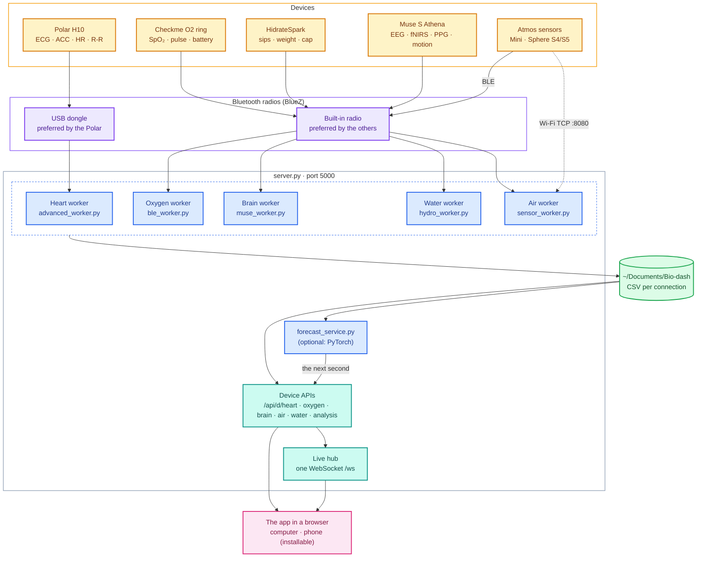

- **Only the devices you own run.** The first-run setup (or Settings → Devices) turns each one on
  or off; that starts or stops its worker. The choice lives in `~/.config/bio-dash/app.json`.
- **A worker that crashes is restarted** after 2 s, then 4, 8 … up to 60 s; a run that lasted two
  minutes resets the pause. Its last 400 lines are kept for the Device sheet's *Troubleshooting*.
- **Radio routing:** each device picks a radio by its *address* (stable across reboots) from
  `radio_config.json`, or automatically: the Polar prefers a USB dongle, the rest the built-in radio.
- **Several people** (up to three) each get a Heart and an Oxygen worker of their own; see section 2.
  This replaces Omni, whose old recordings still show up in Analysis.
- **Forecasts** are a separate process (`polar_dashboard/forecast_service.py`), started when a model
  is installed: it reads the first person's ECG as it is recorded and posts the next second to the
  Heart API, which passes it to the open Heart pages.

---

## 2. Inside the server

Workers are separate processes that share a few small files with the server, so a stuck Bluetooth
stack can be restarted without taking the app down.

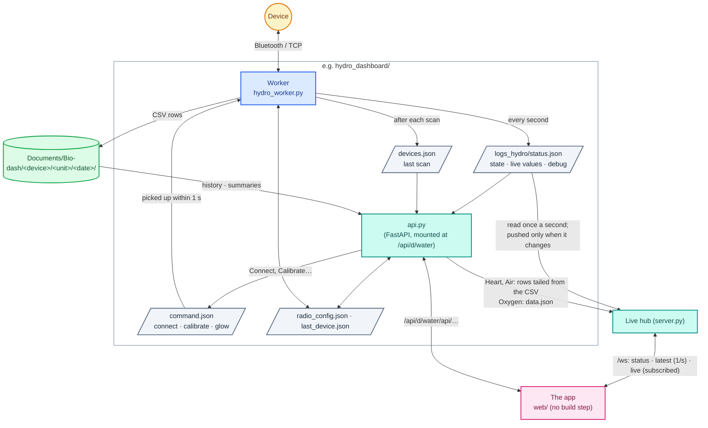

- **One WebSocket per page.** Every page gets each device's status when it changes and a summary
  of the newest readings once a second (Home and the nav dots need nothing else). A device page
  *subscribes* to that device's full stream (130 Hz ECG, every air row) and unsubscribes when you
  leave, so a phone on Home isn't sent the ECG.
- **Nothing is parsed for nobody:** with no page open, the server stops tailing the ECG.
- **Analysis runs apart:** its summaries, charts and export run in a separate process that exits
  a minute after the last request, so a week of parsed recordings doesn't stay in the server.
- **History** (trends, today's water, Analysis) is read back from the recordings, so it survives
  restarts. Finding the newest recording only looks in the newest date folders.
- **Several people.** A worn device (strap, ring) exists once per person. The first person's are
  `heart` and `oxygen`, with their state files in the device folder as always. Each extra person
  (`p2`, `p3`) gets one more worker and one more copy of the same `api.py`, as `heart-p2`,
  `oxygen-p2` …, with `BIODASH_STATE_DIR` pointing at `~/.config/bio-dash/people/<id>/<device>/`
  for their status, command, last-device and radio files (`bt_debug.state_dir`). Nothing else
  differs: the same scan → connect → record loop, the same recordings by device.
  - A worker only ever connects to the device it was told to (or last used), so two workers never
    grab the same strap. Connecting a device for one person first makes whoever had it let go
    (`POST /api/app/claim`).
  - An API follows *its own worker's* recording (the worker lists its files in its status), not
    "the newest file", so two people's live charts and history never cross.
  - With two or more people the server shares the radios out every 10 s: straps take the USB
    dongles first, rings start from the other end; each worker reads its share from its
    `radio_config.json` and follows it unless you pinned a radio.
- **Shared code:** one `bt_debug.py` in the release folder (radios, auto-reconnect, recordings,
  shutdown/reboot, updates). The page is plain ES modules in `web/`: a 7 kB (compressed) canvas chart
  (`plot.js`) replaces Chart.js + luxon + the streaming plugin.

---

## 3. A device's life cycle

The same loop in every worker. Hydro-dash's connect step differs; see section 4.

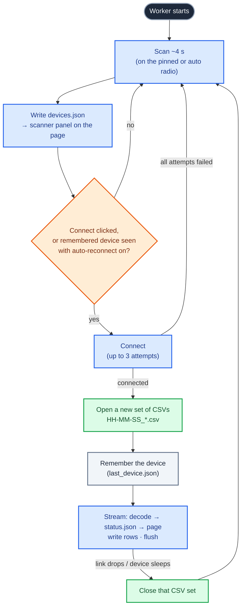

- **One CSV set per connection.** A dropout ends the set; the reconnect starts a new one in the
  same date folder. Timestamps are absolute, so sets line up.
- **Auto-reconnect** can be switched off, or the device forgotten, from each device's **Device** sheet
  (`BIODASH_AUTORECONNECT=0` turns it off by default).

---

## 4. Hydro-dash: the bottle protocol

The PRO 2 sleeps, advertises only briefly after being moved, **changes its address each wake-up**,
and is dropped by BlueZ the moment scanning stops — hence the unusual connect step.

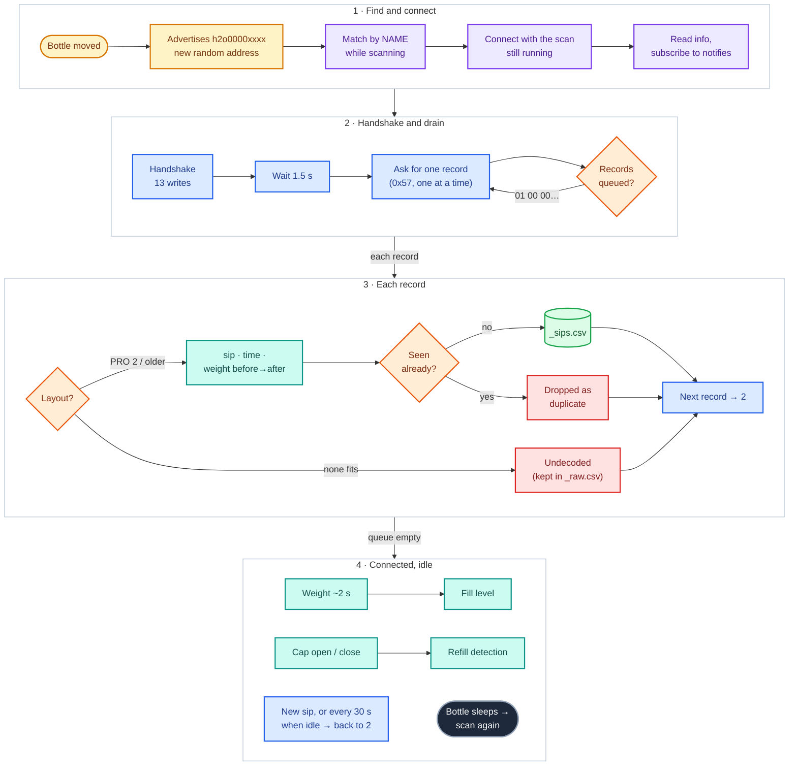

- **Totals, charts, "today"** are computed from `_sips.csv` across all sessions, so replayed sips
  land on the right day and nothing double-counts.
- **Everything raw** goes to `_raw.csv` (every notification, hex) — the basis for decoding new firmware.
- Protocol details and sources: `hydro_dashboard/PROTOCOL.md`.

---

## 5. Atmos: from any sensor format to tiles

One parser handles every Atmos board, over Bluetooth (Nordic UART) or Wi-Fi (TCP).

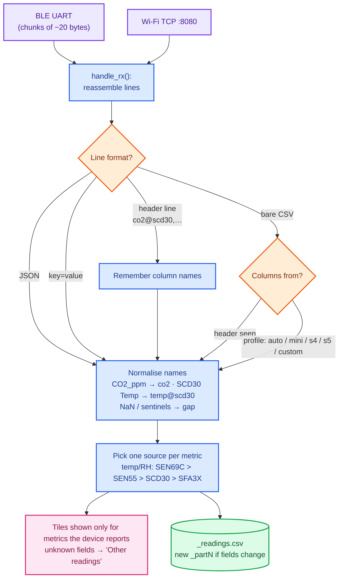

- The firmware for the S4 and SEN69C boards sends a **header line** first, so columns are mapped
  by name and no profile guessing is needed.

---

## 6. Starting and running everything

```mermaid
flowchart LR
    U(["You"]) --> L["./launch.sh<br/>in a terminal, Ctrl+C stops"]
    U --> D["./launch.sh --demo<br/>made-up readings, no Bluetooth"]
    U --> B["./biodash.py<br/>a few questions, or CLI"]
    B -->|install| SVC["systemd user service<br/>biodash-app.service"]
    SVC --> SR["service_run.sh"]
    L & D --> SR
    SR --> VENV{".venv present?"}
    VENV -->|yes| PY1["use .venv/bin/python3"]
    VENV -->|no| PY2["system python3"]
    PY1 & PY2 --> PROC["server.py<br/>→ a worker per device that's on"]
    PROC -.->|"systemd-inhibit, held while it runs"| AWAKE["keep the computer awake<br/>(optional: lid close too)"]
    SVC -.->|"--boot (linger)"| BOOT["start at power-on, no login"]

    classDef device fill:#FEF3C7,stroke:#D97706,color:#78350F,stroke-width:2px
    classDef radio fill:#EDE9FE,stroke:#7C3AED,color:#4C1D95,stroke-width:2px
    classDef worker fill:#DBEAFE,stroke:#2563EB,color:#1E3A8A,stroke-width:2px
    classDef app fill:#CCFBF1,stroke:#0D9488,color:#134E4A,stroke-width:2px
    classDef file fill:#F1F5F9,stroke:#64748B,color:#1E293B,stroke-width:2px
    classDef store fill:#DCFCE7,stroke:#16A34A,color:#14532D,stroke-width:2px
    classDef ui fill:#FCE7F3,stroke:#DB2777,color:#831843,stroke-width:2px
    classDef decision fill:#FFEDD5,stroke:#EA580C,color:#7C2D12,stroke-width:2px
    classDef warn fill:#FEE2E2,stroke:#DC2626,color:#7F1D1D,stroke-width:2px
    classDef start fill:#1E293B,stroke:#94A3B8,color:#F8FAFC,stroke-width:2px
    class U start
    class L,D,B ui
    class SVC,SR file
    class VENV decision
    class PY1,PY2,PROC worker
    class AWAKE,BOOT app
```

- **`./setup_env.sh`** creates the `.venv` once; everything else uses it automatically.
- **Service options** (`biodash.py install`): `--port`, keep awake, `--lid`, `--no-reconnect`,
  `--allow-power` (shut down / update from other devices), `--boot`.
- **Stopping** sends the server SIGTERM (`KillMode=mixed`); it gives each worker Ctrl+C so the
  recordings are closed properly, then exits.
- **From the separate dashboards (V5 – V7):** `biodash.py install` removes the old `biodash-<dashboard>` services and turns on the
  devices they ran, which is exactly what their *Upgrade* button runs.

---

## 7. Hydro-dash: which Bluetooth radio

The bottle is the one device in the suite that is picky about the radio. It has to be **heard**
(it only advertises for a few seconds after it's moved) and it has to get through **reading its
service list**, and the two radios a laptop usually has each fail a different half.

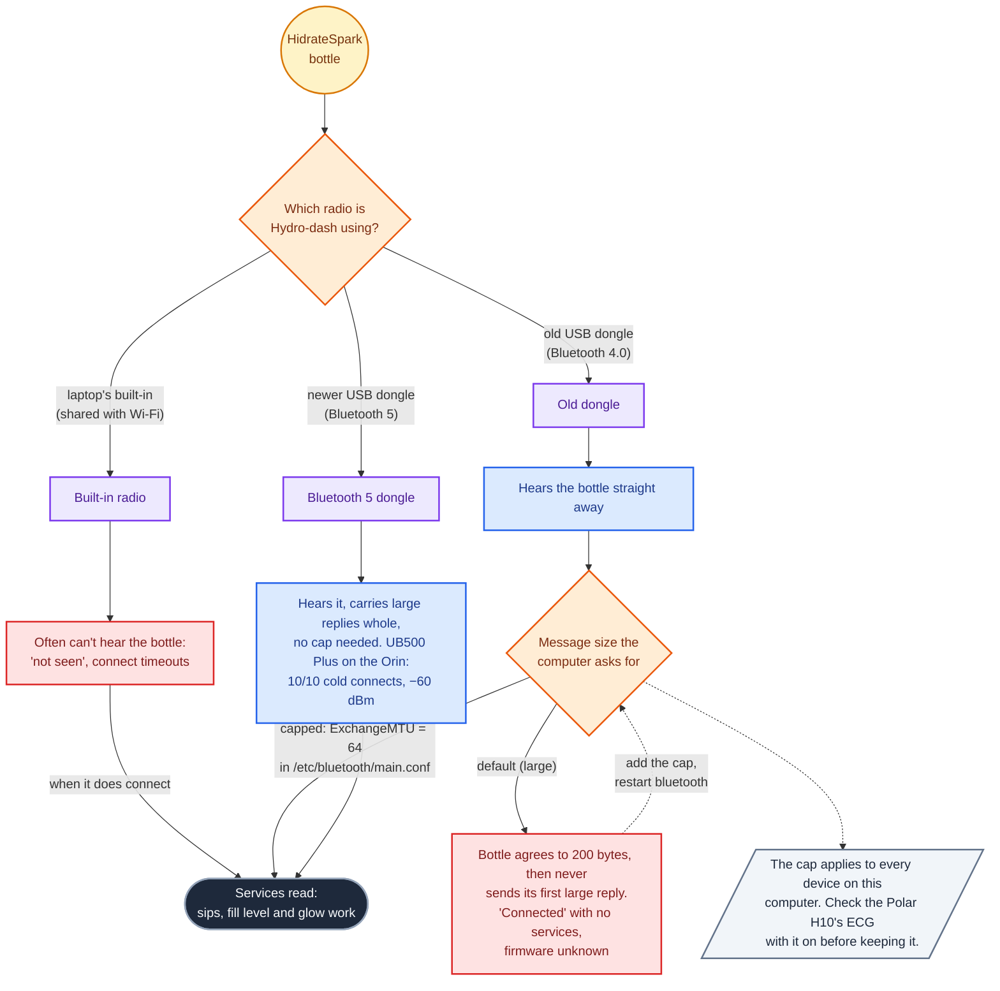

- **What it looks like:** the scanner finds the bottle, the page says connected, and nothing else
  arrives: no firmware version, no battery, no sips.
- **Why:** an old dongle sends 27 bytes per radio packet, so a large reply has to be cut into many
  pieces, and this bottle doesn't send it at all. With small messages every reply fits.
- **The bottle's address changes** from time to time. Each change makes the computer read the
  service list afresh, so this can appear on a setup that worked earlier the same day.
- **Choosing the radio:** the device's **Device** sheet → Bluetooth radio. The choice is saved by the radio's
  address, so it survives reboots (when hci numbers shuffle) and upgrades. Without a choice,
  Hydro-dash prefers a built-in radio; on boards whose USB ports don't say which radios are built in
  (the Orin Nano dev kit), that falls back to whichever radio is hci0.
- Step by step, with the commands: `hydro_dashboard/TROUBLESHOOTING.md`, sections 11 to 15.
- Every adapter tried so far, and why it did or didn't work: [section 9](#9-radios-on-the-orin-what-plugs-in-where).

---

## 8. Analysis: from recordings to one clock

Analysis has no worker and no radio: it reads the CSV recordings the other
dashboards wrote, so it runs anywhere those files are.

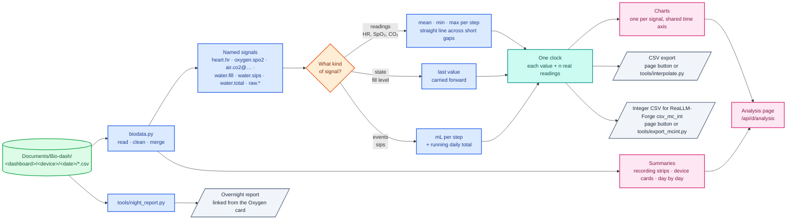

- **Nothing is changed on disk:** the dashboard and the tool only read the recordings (exports and
  reports are written to their own `Exports/` and `Reports/` folders).
- **Signals are merged across dashboards:** heart rate recorded by Polar-dash in the day and by
  Omni at night is one signal.
- **Estimates are marked:** every value carries `n`, the number of real readings behind it;
  0 means interpolated, carried forward, or "no sip in this step" (exports keep the count in `.n` columns).
- **The ReaLLM-Forge export** (`analysis_dashboard/mcint.py`) writes the same table as whole numbers:
  a fixed scale and range per signal, `minute_of_day` / `second` for the time, and one value below
  each range (`-1`) for "no reading", because `csv_mc_int` allows no blank cells.

### Just the ECG (`tools/export_ecg.py`), step by step

The raw file keeps every sample as recorded; the 200 Hz file is resampled stretch by stretch and
never across a gap. With `--with-acc` the accelerometer (`_acc.csv`, X/Y/Z mg, 200 Hz) goes through
the same steps 1-3 on its own clock, is interpolated at each 200 Hz ECG row's time and added as
`ACC_X_mg,ACC_Y_mg,ACC_Z_mg`; a row with no unbroken motion either side ends the stretch there.

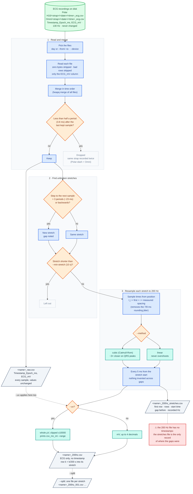

### The ReaLLM-Forge export, step by step

Everything happens when you export; the recordings are never changed. Red notes are the things to
know before training on it (`--max-gap 0 --hold 0 --real-flags` keeps it to real readings).

```mermaid
flowchart TB
    R[("Recordings on disk<br/>&lt;dashboard&gt;/&lt;device&gt;/&lt;date&gt;/*.csv<br/>never changed")]

    subgraph S1["1 · Read: load_signals"]
        direction TB
        A1["Clean<br/>zero bytes stripped · bad rows skipped<br/>timestamps → ms"]
        A2{"Sane range?<br/>HR 25–230 · RR 300–2000<br/>SpO₂ 50–100 · sip 1–2000 mL"}
        A3["Merge dashboards<br/>Polar + Omni = one heart rate<br/>one value per timestamp"]
        A4["Derived signals<br/>HR = 60000/RR (Omni)<br/>RMSSD per minute (skip &gt;20 % jumps)<br/>sips de-duplicated (±10 mL, 2 s) + daily total"]
        A1 --> A2
        A2 -->|yes| A3 --> A4
        A2 -->|no| X1["dropped"]
    end

    subgraph S2["2 · One clock: resample"]
        direction TB
        K{"Kind of signal<br/>(one value per --step)"}
        M["Readings<br/>mean of the step<br/>empty step: straight line<br/>if gap ≤ --max-gap (60 s)"]
        H["Levels (bottle fill)<br/>last value carried<br/>up to 30 min"]
        E["Sips<br/>mL per step · 0 while recording<br/>daily total held to midnight"]
        K --> M & H & E
    end

    subgraph S3["3 · Integers: mcint.build"]
        direction TB
        B1["Scale · round · clip to a fixed range<br/>temp_c_x10 −400…850, hr_bpm 0…250 …"]
        B2["Hold readings across gaps<br/>≤ --hold (2 min)"]
        B3{"Still empty?"}
        B4["−1  (one below the range)<br/>or --missing drop: row left out"]
        B5["minute_of_day (+ second)<br/>rows with no device at all left out"]
        B1 --> B2 --> B3
        B3 -->|yes| B4 --> B5
        B3 -->|no| B5
    end

    OUT[/"Export folder<br/>&lt;name&gt;.csv · .columns.json · .prepare.sh"/]

    subgraph S4["4 · Forge: get_dataset.sh"]
        direction TB
        F1["token = value − int_min<br/>one vocabulary per column"]
        F2["split by row order<br/>first 90 % train · last 10 % val"]
        F1 --> F2
    end

    BIN[("train.bin · val.bin · meta.pkl<br/>per column + manifest.json")]

    R --> A1
    A4 --> K
    M & H & E --> B1
    B5 --> OUT --> F1
    F2 --> BIN

    W1["⚠ up to ~3 min of each gap is made up<br/>(60 s line + 2 min hold) · --real-flags marks it<br/>--max-gap 0 --hold 0 for real data only"]
    W2["⚠ averaging hides beat-to-beat R-R<br/>at 10 s steps · use 1 s or hrv_rmssd_ms"]
    W3["⚠ time jumps where rows are left out<br/>no date column · DST repeats/skips an hour"]
    M -.- W1
    B2 -.- W1
    M -.- W2
    B5 -.- W3

    classDef store fill:#DCFCE7,stroke:#16A34A,color:#14532D,stroke-width:2px
    classDef worker fill:#DBEAFE,stroke:#2563EB,color:#1E3A8A,stroke-width:2px
    classDef decision fill:#FFEDD5,stroke:#EA580C,color:#7C2D12,stroke-width:2px
    classDef app fill:#CCFBF1,stroke:#0D9488,color:#134E4A,stroke-width:2px
    classDef file fill:#F1F5F9,stroke:#64748B,color:#1E293B,stroke-width:2px
    classDef warn fill:#FEE2E2,stroke:#DC2626,color:#7F1D1D,stroke-width:2px
    classDef gone fill:#F8FAFC,stroke:#94A3B8,color:#64748B,stroke-dasharray:4 3
    class R,BIN store
    class A1,A3,A4,M,H,E,B2,B5,F1,F2 worker
    class A2,K,B3 decision
    class B1,B4 app
    class OUT file
    class W1,W2,W3 warn
    class X1 gone
    style S1 fill:#F8FAFC,stroke:#CBD5E1
    style S2 fill:#F8FAFC,stroke:#CBD5E1
    style S3 fill:#F8FAFC,stroke:#CBD5E1
    style S4 fill:#F8FAFC,stroke:#CBD5E1
```

---

## 9. Radios on the Orin: what plugs in where

Every Bluetooth device gets its own radio (one radio streaming a busy device, like the Polar's ECG,
can starve the others). On the Jetson Orin Nano that's four radios for four devices:

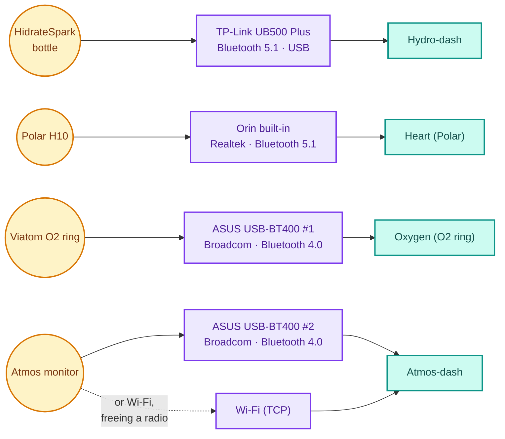

- **The bottle goes on the UB500 Plus.** It's the one device that needs a Bluetooth 5 radio
  (section 7). The O2 ring and the Atmos send small, slow packets that a 4.0 dongle handles fine.
- **The Polar gets a modern radio to itself** because its ECG is the busiest stream.
- **Each device pins its radio by address** in its **Device** sheet → Bluetooth radio
  (saved in `radio_config.json`, carried across upgrades). The hci numbers shuffle whenever
  dongles are added or the Orin boots, and the address is what stays put.

### The boot catch: what's plugged in at power-on

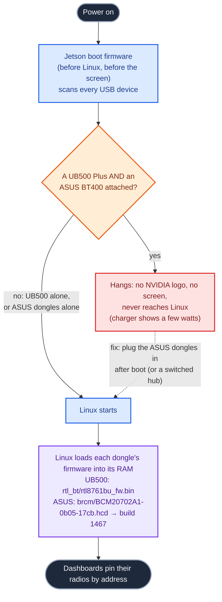

- **Not power:** two ASUS dongles together boot fine, and all four dongles add about 1 W once
  running (7–8 W total, no over-current messages). It's that particular pair at power-on.
- **The dongles' firmware can't fix it.** Neither chip has flash for its firmware: they run what's
  built into the chip, and Linux uploads the improved firmware into their RAM at every power-up,
  after the boot firmware has already met them.
- The Orin's boot firmware here was L4T 36.5.2, the newest of the JetPack 6 line (August 2026).

### Every adapter tried, and why it did or didn't work

| Adapter | Chip · USB ID | Bluetooth | Firmware | With the bottle | Notes |
|---|---|---|---|---|---|
| **TP-Link UB500 Plus** | Realtek RTL8761BU · `2357:0604` (same ID as the plain UB500) | reports 5.1 (box says 5.3) | `rtl_bt/rtl8761bu_fw.bin` + `_config.bin`, loaded by the kernel itself on JetPack 6 (kernel 5.15); no `btusb new_id` needed | ✅ **Works.** 10 of 10 cold connects with all 5 HidrateSpark characteristics; heard 8 times in 25 s at −60 dBm; Hydro-dash picked it by itself after a reboot; no `ExchangeMTU` cap | Antenna plugs in with an **MHF4** connector (the small one, not U.FL): use an MHF4-to-SMA pigtail to move it outside a case |
| **ASUS USB-BT400** | Broadcom BCM20702A1 · `0b05:17cb` | 4.0 | built-in "build 0000"; Linux needs `brcm/BCM20702A1-0b05-17cb.hcd` to bring it to **build 1467** (TROUBLESHOOTING 15) | ⚠ **Hears it instantly, then "connected, no services"**: 4.0 sends 27 bytes per packet and the bottle never sends its first large reply. Works only with `ExchangeMTU = 64`, which affects every device | Fine for the O2 ring and Atmos (small packets). **Stops the Orin booting** if attached together with a UB500 Plus at power-on (above) |
| **Orin Nano built-in** | Realtek 8822-series combo card, Realtek's own `rtk_btusb` driver | 5.1 | built in | not tried with the bottle this round | Its USB port doesn't say it's built in, so the app can't tell it's built in |
| **Laptop built-in** (FW13) | combo card shared with Wi-Fi | 5.x | built in | ❌ **Often doesn't hear it**: the bottle only advertises for a few seconds after it moves, and the shared antenna misses those bursts | TROUBLESHOOTING 11 |

**Powering the Orin:** a 12 V USB-C "trigger" board works only with chargers that offer 12 V,
which USB Power Delivery doesn't require. Any charger over 45 W must offer 20 V, the Orin's normal
input, so a 20 V trigger with a 65 W charger is the dependable choice.

---

## 10. When something's wrong

Start at the top and follow what you see. Each answer points at the fix, and at the place in the
app or the docs that says more.

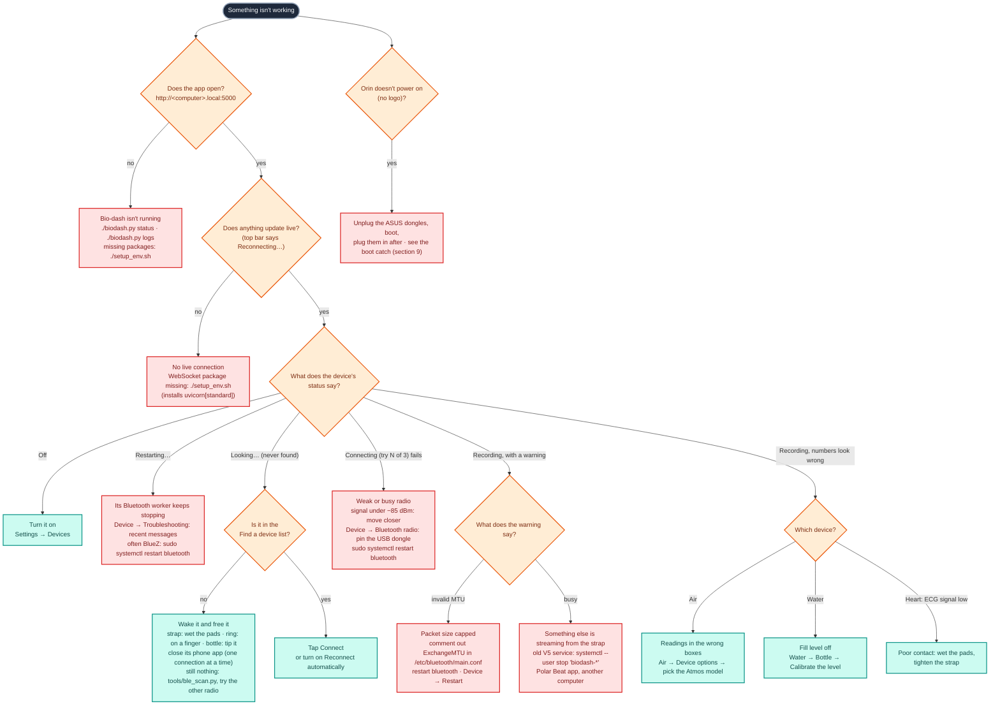

- **Every fix in the app is one or two taps from the device's page:** the status pill, the
  *Connect your …* panel with its *Not showing up?* tips, and the **Device** sheet (radio,
  reconnect, *Troubleshooting* with the worker's recent messages and *Copy details*).
- **Device-specific detail:** the bottle has its own guide, `hydro_dashboard/TROUBLESHOOTING.md`;
  the radios and the Orin's boot catch are in section 9.
